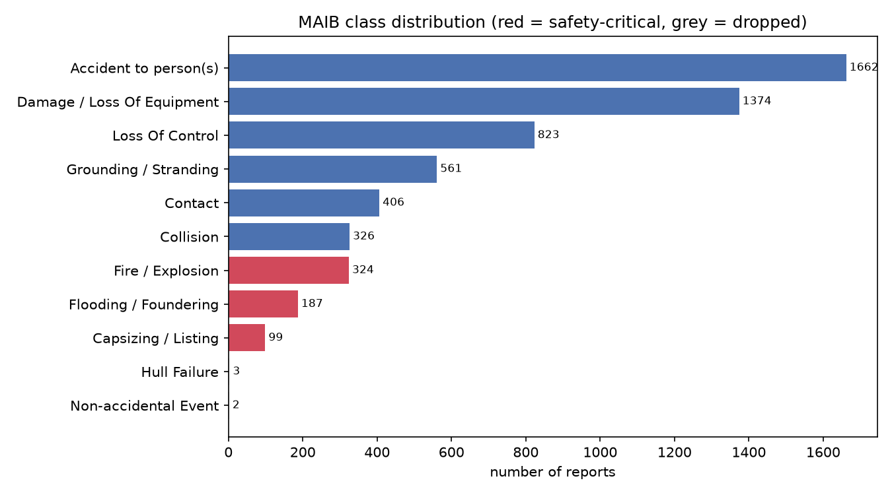
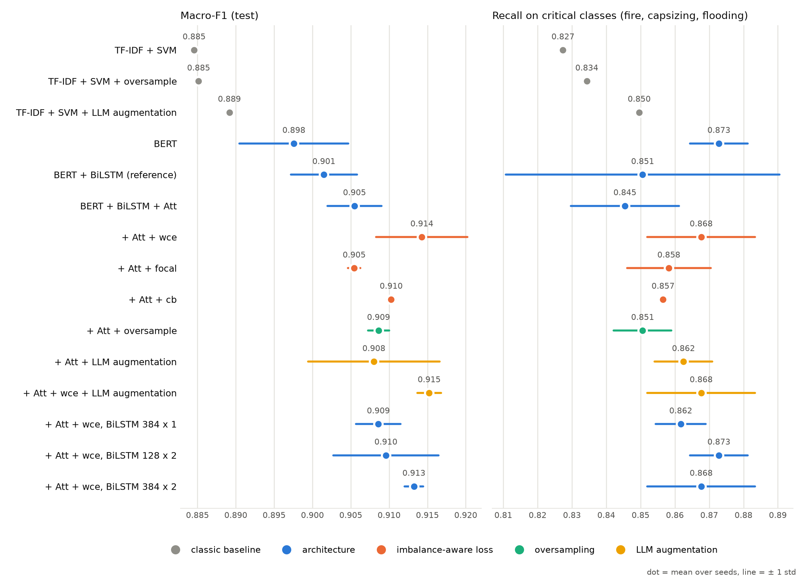
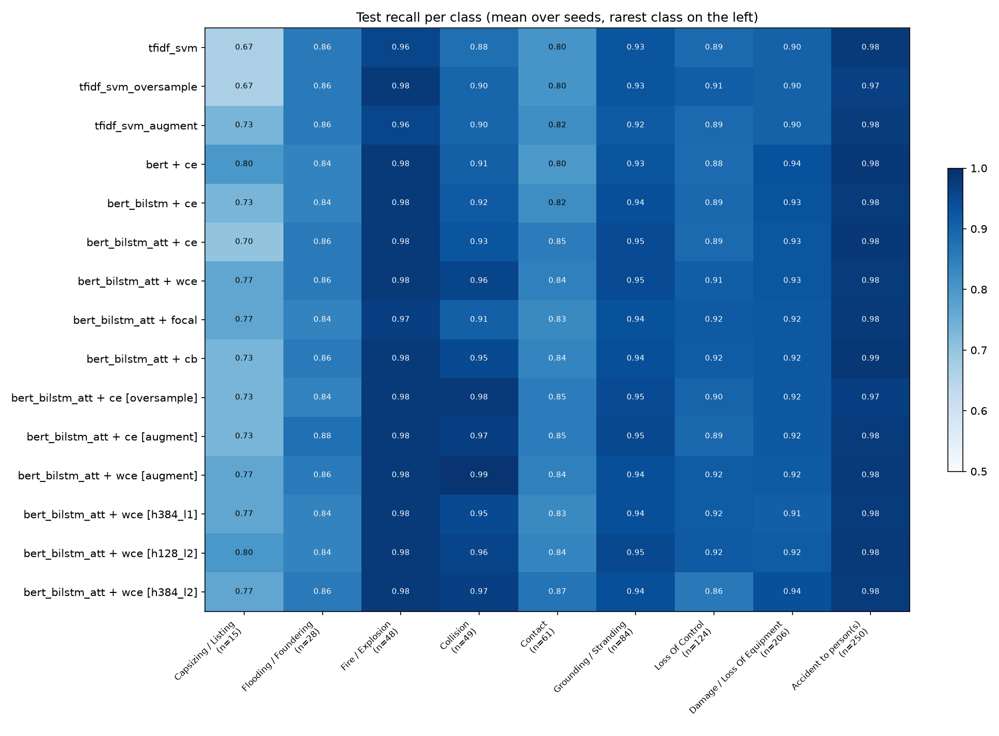
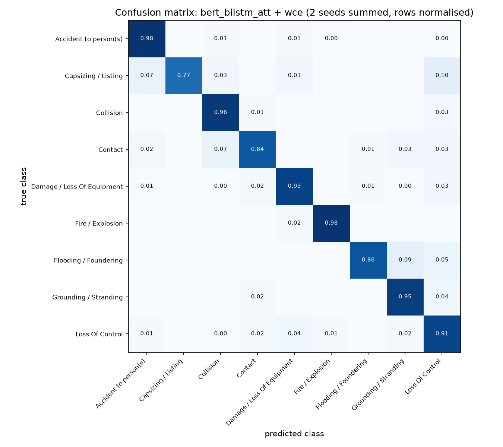

# گزارش کامل نتایج پایان‌نامه

## دسته‌بندی گزارش‌های حوادث دریایی با استفاده از مدل‌های زبانی

محمد مهدی عرب · دانشگاه صنعتی شاهرود · ۲۱ مهر ۱۴۰۵

استاد راهنما: دکتر هدی مشایخی · استاد مشاور: دکتر مریم خدابخش

## خلاصه

- **همه‌ی مدل‌های BERT از خط مبنای کلاسیک (TF-IDF + SVM) بهترند:** Macro-F1 از 0.885 به 0.898 تا 0.915 می‌رسد.
- **تغییر معماری بهبودی بیشتر از نوسان بین seedها نداد:** افزودن BiLSTM، افزودن attention و بزرگ‌تر کردن BiLSTM (تا حدود ۸ برابر پارامتر) هیچ‌کدام بهبود قابل اتکا ندادند.
- **تابع زیان وزن‌دار (wce) مؤثرترین روش بود:** Macro-F1 از 0.905 به 0.914 و بازیابی رده‌های بحرانی از 0.845 به 0.868 رسید. این بهبود از نوسان بین seedها بزرگ‌تر است.
- **oversampling و افزایش داده با مدل زبانی (Data Augmentation)** روی BERT به سطح wce رسیدند، نه بالاتر. افزایش داده روی SVM کمی کمک کرد (0.885 به 0.889).
- **مدل پیشنهادی:** BERT + BiLSTM + Attention با wce؛ Macro-F1 برابر 0.914 ± 0.006 و Accuracy برابر 0.935.

## ۱. مسیر کار در یک نگاه

| گام | کار انجام‌شده | گام پروپوزال |
|---|---|---|
| ۱ | آماده‌سازی داده‌ی عمومی MAIB: پاک‌سازی، ۹ رده، تقسیم ۷۰/۱۵/۱۵ | گام ۱ |
| ۲ | خط مبنای کلاسیک: TF-IDF + SVM | گام ۲ |
| ۳ | بازتولید مقاله‌ی مرجع: BERT و BERT + BiLSTM با تنظیمات یکسان | گام ۲ |
| ۴ | مدل پیشنهادی: BERT + BiLSTM + Attention | گام ۳ |
| ۵ | مقابله با عدم توازن: سه تابع زیان (wce، focal، cb) | گام ۴ |
| ۶ | تحلیل: recall هر رده، ماتریس درهم‌ریختگی، واژه‌های پروزن attention | گام ۵ و ۶ |
| ۷ | درخواست جلسه‌ی قبل: oversampling | تکمیلی |
| ۸ | درخواست‌های جلسه‌ی ۱۹ مهر: افزایش داده با مدل زبانی و BiLSTM بزرگ‌تر | تکمیلی |

**حجم کار:** ۲۴ اجرای آموزش BERT (۱۲ پیکربندی × ۲ seed) و ۳ اجرای SVM؛ در مجموع حدود ۳۱ ساعت آموزش روی GPU لپ‌تاپ (GTX 1650 Ti) و ۲٫۵ ساعت تولید داده با مدل زبانی.

## ۲. داده

دادگان عمومی MAIB (اداره‌ی بررسی حوادث دریایی بریتانیا): ۵٬۷۶۸ گزارش کوتاه انگلیسی. پس از حذف ۱ گزارش تکراری و دو رده‌ی بسیار کوچک (۳ و ۲ گزارش)، ۵٬۷۶۲ گزارش در ۹ رده ماند. نسبت بزرگ‌ترین به کوچک‌ترین رده ۱۶٫۸ است. تقسیم داده طبقه‌بندی‌شده (stratified) و با seed ثابت ۴۲ انجام شد.

| رده | کل | آموزش | آزمون |
|---|---:|---:|---:|
| Accident to person(s) | 1,662 | 1,163 | 250 |
| Damage / Loss of Equipment | 1,374 | 962 | 206 |
| Loss of Control | 823 | 576 | 124 |
| Grounding / Stranding | 561 | 393 | 84 |
| Contact | 406 | 284 | 61 |
| Collision | 326 | 228 | 49 |
| **Fire / Explosion** | 324 | 227 | 48 |
| **Flooding / Foundering** | 187 | 131 | 28 |
| **Capsizing / Listing** | 99 | 69 | 15 |
| **جمع** | **5,762** | **4,033** | **865** |

رده‌های پررنگ «بحرانی» هستند: کمیاب‌اند و بیشترین خطر جانی را دارند. ۸۶۴ گزارش باقی‌مانده برای اعتبارسنجی (انتخاب بهترین epoch) است.

**شکل ۱.** تعداد گزارش‌های هر رده. قرمز: رده‌های بحرانی. خاکستری: رده‌های حذف‌شده.

## ۳. روش ارزیابی

- **Macro-F1:** میانگین F1 همه‌ی ۹ رده با وزن برابر؛ رده‌ی کمیاب همان‌قدر مهم است که رده‌ی پرتکرار. معیار اصلی است.
- **بازیابی رده‌های بحرانی:** میانگین recall سه رده‌ی آتش‌سوزی، واژگونی و آب‌گرفتگی.
- **تکرار:** هر مدل BERT با ۲ seed آموزش دید؛ میانگین ± انحراف معیار گزارش می‌شود. SVM قطعی است و یک بار اجرا شد.
- **قاعده‌ی مقایسه:** تفاوتی واقعی شمرده می‌شود که از بیشترین انحراف معیار دو طرف بزرگ‌تر باشد. این آزمون آماری نیست؛ آزمون McNemar گام بعدی است.
- **تنظیمات یکسان:** همه‌ی مدل‌های BERT با یک دستور آموزش یکسان (bert-base-uncased، ۱۹۲ توکن، batch مؤثر ۳۲، حداکثر ۵ epoch، توقف زودهنگام) آموزش دیدند؛ هر دو پیکربندی پشت‌سرهم فقط در یک جزء تفاوت دارند.

## ۴. جدول اصلی نتایج

مجموعه‌ی آزمون: ۸۶۵ گزارش واقعی.

| پیکربندی | Macro-F1 | بازیابی رده‌های بحرانی | Accuracy |
|---|---:|---:|---:|
| TF-IDF + SVM | 0.885 | 0.827 | 0.914 |
| TF-IDF + SVM با oversampling | 0.885 | 0.834 | 0.917 |
| TF-IDF + SVM با افزایش داده | 0.889 | 0.850 | 0.916 |
| BERT | 0.898 ± 0.007 | 0.873 ± 0.008 | 0.927 |
| BERT + BiLSTM (مقاله‌ی مرجع) | 0.901 ± 0.004 | 0.851 ± 0.040 | 0.928 |
| BERT + BiLSTM + Attention با ce | 0.905 ± 0.004 | 0.845 ± 0.016 | 0.931 |
| **BERT + BiLSTM + Attention با wce (پیشنهادی)** | **0.914 ± 0.006** | **0.868 ± 0.016** | **0.935** |
| BERT + BiLSTM + Attention با focal | 0.905 ± 0.001 | 0.858 ± 0.012 | 0.930 |
| BERT + BiLSTM + Attention با cb | 0.910 ± 0.001 | 0.857 ± 0.000 | 0.935 |
| BERT + BiLSTM + Attention با oversampling | 0.909 ± 0.001 | 0.851 ± 0.008 | 0.931 |
| BERT + BiLSTM + Attention با افزایش داده (ce) | 0.908 ± 0.009 | 0.862 ± 0.008 | 0.932 |
| BERT + BiLSTM + Attention با افزایش داده (wce) | 0.915 ± 0.002 | 0.868 ± 0.016 | 0.935 |
| پیشنهادی با BiLSTM ۳۸۴ واحد، ۱ لایه | 0.909 ± 0.003 | 0.862 ± 0.007 | 0.929 |
| پیشنهادی با BiLSTM ۱۲۸ واحد، ۲ لایه | 0.910 ± 0.007 | 0.873 ± 0.008 | 0.935 |
| پیشنهادی با BiLSTM ۳۸۴ واحد، ۲ لایه | 0.913 ± 0.001 | 0.868 ± 0.016 | 0.932 |

**شکل ۲.** Macro-F1 (چپ) و بازیابی رده‌های بحرانی (راست). نقطه: میانگین دو seed؛ خط: ± یک انحراف معیار. رنگ: نوع تغییر.

## ۵. پاسخ پرسش‌های پژوهش

### پرسش ۱: آیا معماری پیچیده‌تر کمک می‌کند؟

| مقایسه | تغییر Macro-F1 | نوسان (انحراف معیار) | حکم |
|---|---:|---:|---|
| BERT در برابر SVM | 0.013 بیشتر | 0.007 | **بزرگ‌تر از نوسان** |
| BERT + BiLSTM در برابر BERT | 0.004 بیشتر | 0.007 | در حد نوسان |
| + Attention در برابر BERT + BiLSTM | 0.004 بیشتر | 0.004 | در حد نوسان |
| BiLSTM ۳۸۴×۱ در برابر ۱۲۸×۱ (هر دو wce) | 0.006 کمتر | 0.006 | در حد نوسان |
| BiLSTM ۱۲۸×۲ در برابر ۱۲۸×۱ | 0.005 کمتر | 0.007 | در حد نوسان |
| BiLSTM ۳۸۴×۲ در برابر ۱۲۸×۱ | 0.001 کمتر | 0.006 | در حد نوسان |

### پرسش ۲: کدام روش مقابله با عدم توازن کمک می‌کند؟

همه نسبت به BERT + BiLSTM + Attention با ce:

| روش | تغییر Macro-F1 | تغییر بازیابی بحرانی | حکم |
|---|---:|---:|---|
| **wce** | **0.009 بیشتر** | **0.022 بیشتر** | **بزرگ‌تر از نوسان** |
| cb | 0.005 بیشتر | 0.011 بیشتر | کمی بزرگ‌تر از نوسان |
| focal | بدون تغییر | 0.013 بیشتر | در حد نوسان |
| oversampling | 0.003 بیشتر | 0.005 بیشتر | در حد نوسان |
| افزایش داده | 0.003 بیشتر | 0.017 بیشتر | در حد نوسان |
| wce + افزایش داده (نسبت به wce) | 0.001 بیشتر | بدون تغییر | در حد نوسان |

## ۶. نتایج هر رده

تعداد گزارش‌های آزمونِ درست تشخیص داده‌شده (میانگین دو seed)؛ کمیاب‌ترین رده بالاست:

| رده (تعداد در آزمون) | SVM | BERT | + BiLSTM | + Attention | + Attention + wce |
|---|---:|---:|---:|---:|---:|
| Capsizing (15) | 10 | 12 | 11 | 10.5 | 11.5 |
| Flooding (28) | 24 | 23.5 | 23.5 | 24 | 24 |
| Fire (48) | 46 | 47 | 47 | 47 | 47 |
| Collision (49) | 43 | 44.5 | 45 | 45.5 | 47 |
| Contact (61) | 49 | 48.5 | 50 | 52 | 51.5 |
| Grounding (84) | 78 | 78 | 79 | 79.5 | 79.5 |
| Loss of Control (124) | 110 | 109.5 | 110.5 | 110 | 113 |
| Damage (206) | 186 | 193 | 192 | 191 | 191 |
| Accident (250) | 245 | 246 | 244.5 | 246 | 244.5 |

wce با ۳٫۵ گزارش درست بیشتر در مجموع، خطا را از پرتکرارترین رده (Accident، ۱٫۵ گزارش کمتر) به رده‌های کوچک‌تر (Capsizing، Collision و Loss of Control) جابه‌جا کرد. با ۱۵ گزارش واژگونی در آزمون، هر گزارش ۶٫۷ درصد recall است؛ پس تفاوت‌های ۱ تا ۲ گزارشی میان مدل‌های BERT قابل اتکا نیست.

**شکل ۳.** recall هر رده برای همه‌ی پیکربندی‌ها (میانگین seedها؛ کمیاب‌ترین رده در چپ).

## ۷. ماتریس درهم‌ریختگی و تحلیل خطا

**شکل ۴.** ماتریس درهم‌ریختگی مدل پیشنهادی (BERT + BiLSTM + Attention با wce)، جمع دو seed. هر سطر نرمال شده است، پس قطر اصلی همان recall است.

مدل پیشنهادی در مجموع دو seed، ۱۱۲ اشتباه از ۱٬۷۳۰ پیش‌بینی داشت. پرتکرارترین اشتباه‌ها:

| رده‌ی واقعی | پیش‌بینی مدل | تعداد |
|---|---|---:|
| Damage / Loss of Equipment | Loss of Control | 13 |
| Loss of Control | Damage / Loss of Equipment | 9 |
| Contact | Collision | 8 |
| Damage / Loss of Equipment | Contact | 7 |
| Grounding | Loss of Control | 6 |
| Flooding | Grounding | 5 |

بیشتر اشتباه‌ها میان رده‌هایی است که **علت و پیامد** یک رخداد را نام می‌برند. نمونه: «خرابی پیشرانه، سپس به گل نشستن» برچسب Grounding دارد، اما می‌تواند Loss of Control هم باشد. یعنی بخشی از خطا از **تک‌برچسبی بودن** گزارش‌های چندرویدادی می‌آید، نه از ضعف مدل.

**واژه‌های پروزن attention** (بیشترین مجموع وزن در گزارش‌های آزمونی که درست دسته‌بندی شدند):

| رده | واژه‌ها |
|---|---|
| Accident | fell، sustained، passenger، injury، fractured |
| Capsizing | capsized |
| Collision | collided، manoeuvring، tanker، moored |
| Contact | contact، quayside، struck، lock |
| Damage | solas، ladder، pilot، conform، regulations |
| Fire | engine، caught، smoke، extinguish |
| Flooding | ingress، water، taking |
| Grounding | grounded، ran، aground، sandbank |
| Loss of Control | failure، engine، fouled، propulsion، propeller |

یافته‌ی جالب: در رده‌ی Damage، attention بیشتر روی واژه‌های **نردبان راهنما (pilot ladder) و مقررات SOLAS** است. یعنی بخش بزرگی از این رده، گزارش‌های نردبان راهنمای غیراستاندارد است.

## ۸. افزایش داده با مدل زبانی (درخواست جلسه‌ی ۱۹ مهر)

oversampling همان گزارش‌های کمیاب را تکرار می‌کند و اطلاعات تازه‌ای نمی‌دهد. در افزایش داده، یک مدل زبانی هر گزارش آموزشی واقعی را با واژه‌ها و ساختار جمله‌ی تازه بازنویسی می‌کند. واقعیت‌های حادثه، و در نتیجه برچسب، همان می‌ماند.

| بخش | انتخاب |
|---|---|
| مدل زبانی | Qwen2.5-1.5B-Instruct، اجرای محلی روی GPU لپ‌تاپ |
| دستور (prompt) | گزارش را با واژه‌ها و ساختار تازه بازنویسی کن؛ نوع شناور، رخداد، علت، آسیب‌ها و خسارت را دقیقاً حفظ کن؛ واقعیت تازه اضافه نکن و نام رده را نیاور |
| داده‌ی ورودی | فقط گزارش‌های **آموزشی**؛ داده‌ی اعتبارسنجی و آزمون هرگز به مدل زبانی داده نشد |
| هدف | هر رده‌ی کمتر از ۴۰۰ گزارش آموزشی تا ۴۰۰ پر شد |
| صافی‌ها | طول بین نصف و دو برابر اصل؛ هم‌پوشانی واژه‌ها بین 0.15 و 0.8؛ حذف تکراری‌ها |
| بررسی برچسب | یک TF-IDF + SVM آموزش‌دیده فقط روی داده‌ی واقعی باید بازنویسی را در رده‌ی اصلش بگذارد (مانند LAMBADA)؛ ردشده‌ها با بازنویسی تازه جایگزین شدند |

| رده | واقعی | تولیدشده | پذیرفته | نرخ پذیرش | مجموع آموزشی |
|---|---:|---:|---:|---:|---:|
| Capsizing | 69 | 487 | 331 | 68٪ | 400 |
| Flooding | 131 | 408 | 269 | 66٪ | 400 |
| Fire | 227 | 184 | 173 | 94٪ | 400 |
| Collision | 228 | 187 | 172 | 92٪ | 400 |
| Contact | 284 | 215 | 116 | 54٪ | 400 |
| Grounding | 393 | 12 | 7 | 58٪ | 400 |
| **جمع** | | **1,493** | **1,068** | **71.5٪** | |

داده‌ی آموزشی از ۴٬۰۳۳ به ۵٬۱۰۱ گزارش رسید.

**نتیجه:**

| مدل | Macro-F1 بدون افزایش داده | Macro-F1 با افزایش داده | بازیابی بحرانی بدون افزایش داده | بازیابی بحرانی با افزایش داده | حکم |
|---|---:|---:|---:|---:|---|
| TF-IDF + SVM | 0.885 | 0.889 | 0.827 | 0.850 | بهبود کوچک (تک‌اجرا) |
| پیشنهادی با ce | 0.905 | 0.908 | 0.845 | 0.862 | در حد نوسان |
| پیشنهادی با wce | 0.914 | 0.915 | 0.868 | 0.868 | در حد نوسان |

با ce، افزایش داده و oversampling عملاً برابرند (0.908 در برابر 0.909).

| رده (تعداد در آزمون) | ce | ce با افزایش داده | wce | wce با افزایش داده |
|---|---:|---:|---:|---:|
| Capsizing (15) | 10.5 | 11 | 11.5 | 11.5 |
| Flooding (28) | 24 | 24.5 | 24 | 24 |
| Fire (48) | 47 | 47 | 47 | 47 |
| Collision (49) | 45.5 | 47.5 | 47 | 48.5 |
| Contact (61) | 52 | 52 | 51.5 | 51.5 |

**چرا روی BERT کمک نکرد؟** بازنویسی **واژه‌ی تازه** می‌آورد، نه **واقعیت تازه**. SVM هر واژه را ویژگی جدا می‌بیند، پس مترادف تازه برایش ویژگی تازه است و کمک می‌کند. BERT از پیش‌آموزش می‌داند که capsized و overturned هم‌معنا هستند؛ برای BERT بازنویسی همان اطلاعات قبلی است. این با یافته‌ی Longpre و همکاران (۲۰۲۰) هم‌خوان است. هزینه: ۲٫۵ ساعت تولید و ۲۲٪ زمان آموزش بیشتر (۹۲ به‌جای ۷۵ دقیقه برای هر اجرا).

**محدودیت:** بررسی دستی نشان داد که نوع رخداد حفظ می‌شود، اما جزئیات فرعی گاهی تغییر می‌کند (مثلاً lifeboat به liferaft). بررسی برچسب سخت‌گیر است و گاهی بازنویسی درست را هم رد می‌کند.

## ۹. BiLSTM بزرگ‌تر (درخواست جلسه‌ی ۱۹ مهر)

خروجی BERT برای هر توکن ۷۶۸ بعد دارد. BiLSTM پیش‌فرض در هر جهت ۱۲۸ واحد و خروجی ۲۵۶ بعدی دارد. سه پیکربندی بزرگ‌تر با wce و ۲ seed آزموده شد:

| BiLSTM | پارامترهای BiLSTM | Macro-F1 | بازیابی بحرانی | Accuracy | زمان هر اجرا |
|---|---:|---:|---:|---:|---:|
| ۱۲۸ واحد، ۱ لایه (پیش‌فرض) | 0.92M | **0.914 ± 0.006** | 0.868 ± 0.016 | 0.935 | ۷۶ دقیقه |
| ۳۸۴ واحد، ۱ لایه (هم‌اندازه‌ی BERT) | 3.5M | 0.909 ± 0.003 | 0.862 ± 0.007 | 0.929 | ۷۵ دقیقه |
| ۱۲۸ واحد، ۲ لایه | 1.3M | 0.910 ± 0.007 | 0.873 ± 0.008 | 0.935 | ۶۷ دقیقه |
| ۳۸۴ واحد، ۲ لایه | 7.1M | 0.913 ± 0.001 | 0.868 ± 0.016 | 0.932 | ۷۶ دقیقه |

هیچ‌کدام از پیش‌فرض بهتر نشد؛ همه‌ی تفاوت‌ها در حد نوسان است.

**چرا؟**

1. BERT با ۱۱۰ میلیون پارامتر و ۱۲ لایه‌ی self-attention کار اصلی را انجام می‌دهد. BiLSTM فقط خروجی آن را دوباره می‌خواند؛ حتی بزرگ‌ترینش (۷ میلیون پارامتر) اطلاعات تازه‌ای به آن اضافه نمی‌کند.
2. لازم نیست خروجی BiLSTM هم‌اندازه‌ی BERT باشد: ورودی BiLSTM در همه‌ی حالت‌ها همان ۷۶۸ بعد است. اندازه‌ی BiLSTM فقط اندازه‌ی خلاصه‌ای است که برای ۹ رده ساخته می‌شود، و ۲۵۶ عدد برای این کار کافی است.
3. نشانه‌ی حفظ کردن داده: در seed اول، با ۳۸۴ واحد خطای آموزش کمتر شد (0.064 در برابر 0.081)، اما Macro-F1 اعتبارسنجی همان ماند (0.915). ظرفیت اضافه صرف حفظ کردن داده‌ی آموزش شد، نه یادگیری بهتر.

این نتیجه یافته‌ی پرسش ۱ را تقویت می‌کند: **گلوگاه این مسئله معماری نیست.**

## ۱۰. جمع‌بندی

1. **مدل پیشنهادی:** BERT + BiLSTM + Attention با wce؛ Macro-F1 برابر 0.914 و بازیابی رده‌های بحرانی 0.868.
2. **تابع زیان مهم‌تر از معماری است:** wce با تغییر یک خط کد، بیشتر از هر لایه‌ی اضافه کمک کرد.
3. **روش‌های بر پایه‌ی داده** (oversampling و افزایش داده) به سطح wce رسیدند، نه بالاتر، و هزینه‌ی بیشتری دارند.
4. **سقف حدود 0.91** بیشتر از ابهام برچسب گزارش‌های چندرویدادی می‌آید تا از کمبود ظرفیت مدل.
5. **attention** برای تفسیرپذیری ارزش دارد (یافته‌ی SOLAS و نردبان راهنما)، نه برای دقت.

**محدودیت‌ها:** فقط ۲ seed و بدون آزمون آماری؛ مجموعه‌ی آزمون کوچک برای رده‌های کمیاب (۱۵ گزارش واژگونی)؛ یک تقسیم داده؛ فقط BERT پایه؛ مدل زبانی کوچک (۱٫۵ میلیارد پارامتر) به دلیل GPU چهار گیگابایتی.

## ۱۱. پرسش‌ها از استاد راهنما

1. آیا wce را روش نهایی مقابله با عدم توازن در نظر بگیرم و oversampling و افزایش داده را به‌عنوان آزمایش‌های مقایسه‌ای در مقاله گزارش کنم؟
2. برای محکم‌تر شدن نتایج، کدام را در اولویت بگذارم: seed سوم برای مقایسه‌های اصلی، یا آزمون آماری McNemar روی همین اجراها؟
3. برای مقاله، کدام نشریه یا کنفرانس را مناسب می‌دانید؟

## منابع

- Anaby-Tavor, A., et al. (2020). Do Not Have Enough Data? Deep Learning to the Rescue! AAAI.
- Cui, Y., et al. (2019). Class-Balanced Loss Based on Effective Number of Samples. CVPR.
- Devlin, J., et al. (2019). BERT: Pre-training of Deep Bidirectional Transformers for Language Understanding. NAACL.
- Lin, T.-Y., et al. (2017). Focal Loss for Dense Object Detection. ICCV.
- Longpre, S., Wang, Y., & DuBois, C. (2020). How Effective is Task-Agnostic Data Augmentation for Pretrained Transformers? Findings of EMNLP.
- Qwen Team (2024). Qwen2.5 Technical Report. arXiv:2412.15115.
- Zhao, Z., Liu, X., Feng, L., Grifoll, M., & Feng, H. (2025). Causation Analysis of Marine Traffic Accidents Using Deep Learning Approaches: A Case Study from China's Coasts. Systems, 13(4), 284.
- Zhou, P., et al. (2016). Attention-Based Bidirectional Long Short-Term Memory Networks for Relation Classification. ACL.

کد و همه‌ی نتایج: پوشه‌ی `maib-thesis/` در مخزن پروژه.
