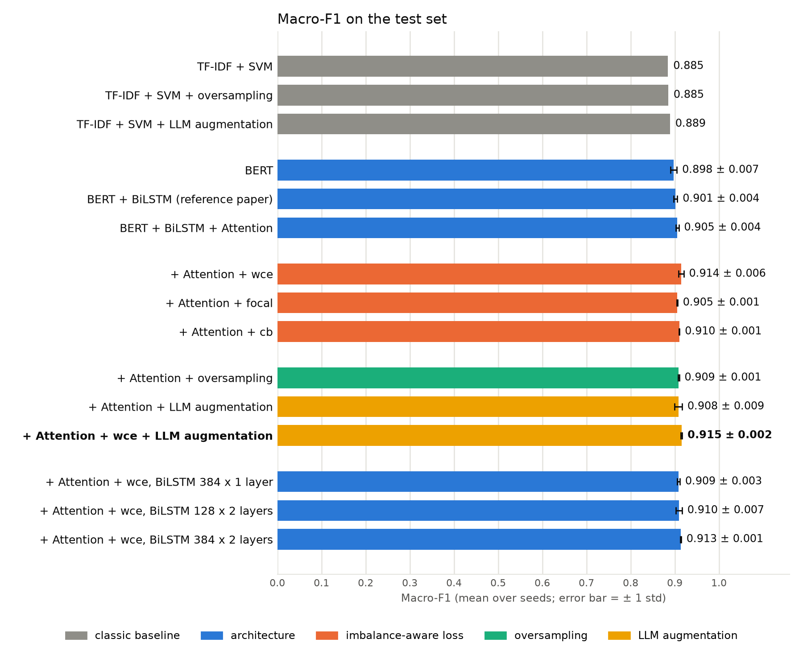
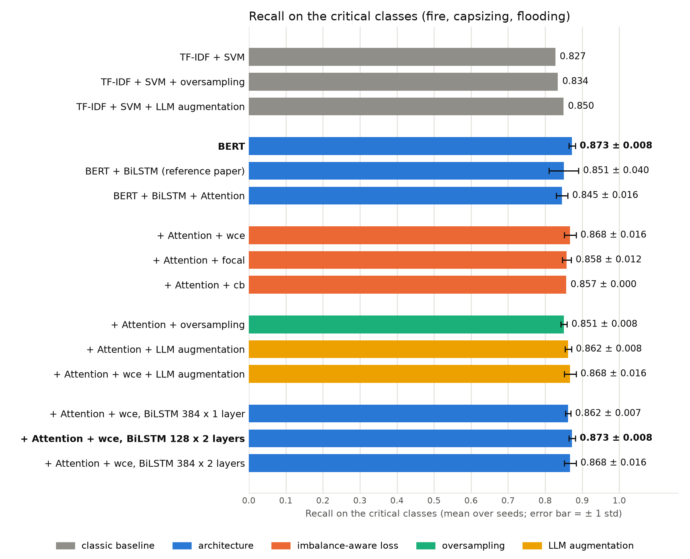
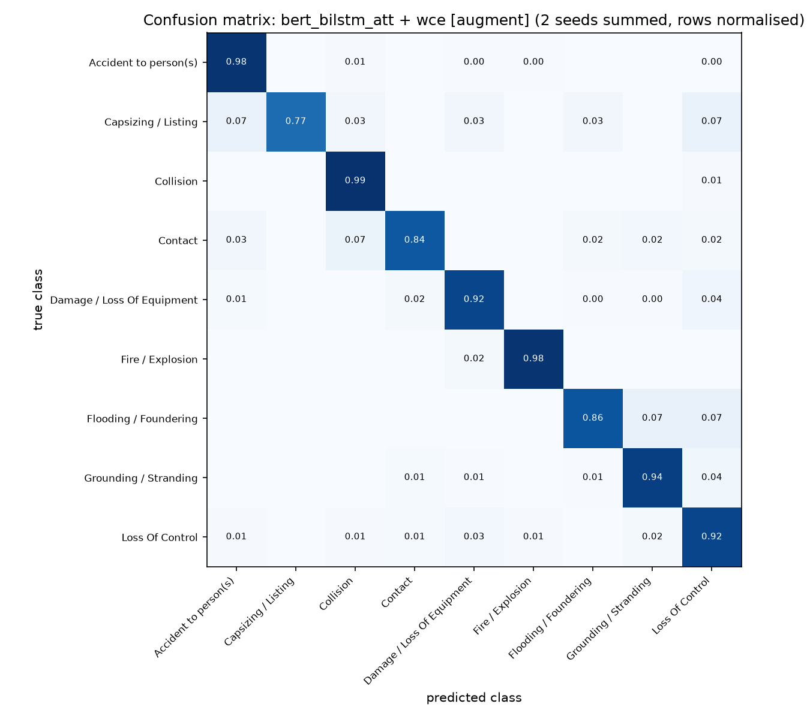

# نتایج آزمایش‌های پایان‌نامه

## دسته‌بندی گزارش‌های حوادث دریایی با استفاده از مدل‌های زبانی

محمد مهدی عرب · ۲۱ مهر ۱۴۰۵

استاد راهنما: دکتر هدی مشایخی · استاد مشاور: دکتر مریم خدابخش

## خلاصه‌ی نتایج

1. **بهترین پیکربندی:** BERT + BiLSTM + Attention با تابع زیان وزن‌دار (wce) و افزایش داده با مدل زبانی؛ Macro-F1 برابر **0.915 ± 0.002** (بیشترین مقدار در همه‌ی آزمایش‌ها)، بازیابی رده‌های بحرانی 0.868 و Accuracy برابر 0.935.
2. بیشترین سهم این بهبود از wce است: Macro-F1 از 0.905 (ce) به 0.914 (wce) رسید. افزودن افزایش داده به wce مقدار 0.001 دیگر افزود که در حد نوسان بین seedهاست، و پراکندگی بین دو اجرا را از 0.006 به 0.002 کاهش داد.
3. همه‌ی مدل‌های مبتنی بر BERT از خط مبنای TF-IDF + SVM بهترند (Macro-F1 برابر 0.898 تا 0.915 در برابر 0.885). افزایش داده روی SVM هم بهبود کوچکی داد (0.885 به 0.889).
4. افزودن BiLSTM و attention به BERT، و بزرگ‌تر کردن BiLSTM، بهبودی بیشتر از نوسان نداد. بیشترین بازیابی رده‌های بحرانی (0.873) را BERT ساده و BiLSTM دولایه داشتند؛ تفاوت آن با بهترین پیکربندی (0.868) در حد نوسان است.
5. بیشتر خطاهای باقی‌مانده میان رده‌هایی است که علت و پیامد یک رخداد را نام می‌برند.

## ۱. تنظیمات آزمایش

- **داده:** دادگان عمومی MAIB؛ ۵٬۷۶۲ گزارش در ۹ رده؛ نسبت بزرگ‌ترین به کوچک‌ترین رده ۱۶٫۸. تقسیم طبقه‌بندی‌شده‌ی ۷۰/۱۵/۱۵: ۴٬۰۳۳ آموزش، ۸۶۴ اعتبارسنجی، ۸۶۵ آزمون.
- **معیارها:** Macro-F1 (معیار اصلی)؛ بازیابی رده‌های بحرانی، یعنی میانگین recall سه رده‌ی آتش‌سوزی، واژگونی و آب‌گرفتگی؛ Accuracy.
- **مدل‌های BERT:** bert-base-uncased با تنظیمات آموزش یکسان (۱۹۲ توکن، batch مؤثر ۳۲، حداکثر ۵ epoch، انتخاب بهترین epoch با Macro-F1 اعتبارسنجی). هر پیکربندی با ۲ seed آموزش دید و میانگین ± انحراف معیار گزارش شده است. SVM قطعی است و یک بار اجرا شد.
- **قاعده‌ی مقایسه:** تفاوتی که از بیشترین انحراف معیار دو طرف بزرگ‌تر باشد «بزرگ‌تر از نوسان» شمرده شده است. آزمون آماری هنوز انجام نشده است.
- **حجم:** ۲۴ اجرای BERT (۱۲ پیکربندی × ۲ seed) و ۳ اجرای SVM.

## ۲. نتایج اصلی

**جدول ۱.** نتایج همه‌ی پیکربندی‌ها روی مجموعه‌ی آزمون (۸۶۵ گزارش). عدد پررنگ: بیشترین مقدار هر ستون.

| پیکربندی | Macro-F1 | بازیابی رده‌های بحرانی | Accuracy |
|---|---:|---:|---:|
| TF-IDF + SVM | 0.885 | 0.827 | 0.914 |
| TF-IDF + SVM با oversampling | 0.885 | 0.834 | 0.917 |
| TF-IDF + SVM با افزایش داده | 0.889 | 0.850 | 0.916 |
| BERT | 0.898 ± 0.007 | **0.873 ± 0.008** | 0.927 |
| BERT + BiLSTM (مقاله‌ی مرجع) | 0.901 ± 0.004 | 0.851 ± 0.040 | 0.928 |
| BERT + BiLSTM + Attention با ce | 0.905 ± 0.004 | 0.845 ± 0.016 | 0.931 |
| BERT + BiLSTM + Attention با wce | 0.914 ± 0.006 | 0.868 ± 0.016 | **0.935** |
| BERT + BiLSTM + Attention با focal | 0.905 ± 0.001 | 0.858 ± 0.012 | 0.930 |
| BERT + BiLSTM + Attention با cb | 0.910 ± 0.001 | 0.857 ± 0.000 | **0.935** |
| BERT + BiLSTM + Attention با oversampling | 0.909 ± 0.001 | 0.851 ± 0.008 | 0.931 |
| BERT + BiLSTM + Attention با افزایش داده (ce) | 0.908 ± 0.009 | 0.862 ± 0.008 | 0.932 |
| **BERT + BiLSTM + Attention با wce و افزایش داده (بهترین)** | **0.915 ± 0.002** | 0.868 ± 0.016 | **0.935** |
| Attention با wce، BiLSTM ۳۸۴ واحد، ۱ لایه | 0.909 ± 0.003 | 0.862 ± 0.007 | 0.929 |
| Attention با wce، BiLSTM ۱۲۸ واحد، ۲ لایه | 0.910 ± 0.007 | **0.873 ± 0.008** | **0.935** |
| Attention با wce، BiLSTM ۳۸۴ واحد، ۲ لایه | 0.913 ± 0.001 | 0.868 ± 0.016 | 0.932 |

**شکل ۱.** Macro-F1 همه‌ی پیکربندی‌ها. طول میله: میانگین دو seed؛ خط سیاه: ± یک انحراف معیار؛ رنگ: نوع تغییر؛ پررنگ: بیشترین مقدار.

**شکل ۲.** بازیابی رده‌های بحرانی (آتش‌سوزی، واژگونی و آب‌گرفتگی)؛ نشانه‌گذاری مانند شکل ۱.

## ۳. مقایسه‌ها

**جدول ۲.** تفاوت هر پیکربندی با پیکربندی پایه‌ی آن.

| مقایسه | تغییر Macro-F1 | تغییر بازیابی بحرانی | حکم |
|---|---:|---:|---|
| **معماری** | | | |
| BERT در برابر TF-IDF + SVM | +0.013 | +0.045 | **بزرگ‌تر از نوسان** |
| BERT + BiLSTM در برابر BERT | +0.004 | −0.022 | در حد نوسان |
| + Attention در برابر BERT + BiLSTM | +0.004 | −0.005 | در حد نوسان |
| BiLSTM ۳۸۴×۱ در برابر ۱۲۸×۱ (هر دو wce) | −0.006 | −0.006 | در حد نوسان |
| BiLSTM ۱۲۸×۲ در برابر ۱۲۸×۱ | −0.005 | +0.005 | در حد نوسان |
| BiLSTM ۳۸۴×۲ در برابر ۱۲۸×۱ | −0.001 | 0.000 | در حد نوسان |
| **عدم توازن** (نسبت به Attention با ce) | | | |
| wce | +0.009 | +0.022 | **بزرگ‌تر از نوسان** |
| cb | +0.005 | +0.011 | کمی بزرگ‌تر از نوسان |
| focal | 0.000 | +0.013 | در حد نوسان |
| oversampling | +0.003 | +0.005 | در حد نوسان |
| افزایش داده | +0.003 | +0.017 | در حد نوسان |
| wce با افزایش داده | +0.010 | +0.022 | **بزرگ‌تر از نوسان** |
| wce با افزایش داده، نسبت به wce | +0.001 | 0.000 | در حد نوسان |
| **SVM** (نسبت به SVM) | | | |
| oversampling | +0.001 | +0.007 | تک‌اجرا |
| افزایش داده | +0.005 | +0.022 | تک‌اجرا |

## ۴. نتایج هر رده

**جدول ۳.** تعداد گزارش‌های آزمونِ درست تشخیص داده‌شده (میانگین دو seed)؛ کمیاب‌ترین رده بالاست.

| رده (تعداد در آزمون) | SVM | BERT | + BiLSTM | + Attention | + wce | + wce + افزایش داده (بهترین) |
|---|---:|---:|---:|---:|---:|---:|
| Capsizing / Listing (15) | 10 | 12 | 11 | 10.5 | 11.5 | 11.5 |
| Flooding / Foundering (28) | 24 | 23.5 | 23.5 | 24 | 24 | 24 |
| Fire / Explosion (48) | 46 | 47 | 47 | 47 | 47 | 47 |
| Collision (49) | 43 | 44.5 | 45 | 45.5 | 47 | 48.5 |
| Contact (61) | 49 | 48.5 | 50 | 52 | 51.5 | 51.5 |
| Grounding / Stranding (84) | 78 | 78 | 79 | 79.5 | 79.5 | 79 |
| Loss of Control (124) | 110 | 109.5 | 110.5 | 110 | 113 | 113.5 |
| Damage / Loss of Equipment (206) | 186 | 193 | 192 | 191 | 191 | 189 |
| Accident to person(s) (250) | 245 | 246 | 244.5 | 246 | 244.5 | 245 |
| **جمع درست (865)** | 791 | 802 | 802.5 | 805.5 | 809 | 809 |

wce نسبت به ce در مجموع ۳٫۵ گزارش درست بیشتر داشت: ۱٫۵ گزارش کمتر در پرتکرارترین رده (Accident) و در عوض گزارش‌های بیشتر در Capsizing، Collision و Loss of Control. افزودن افزایش داده به wce تعداد کل درست‌ها را تغییر نداد (۸۰۹ در هر دو)؛ در Collision ۱٫۵ گزارش بیشتر و در Damage ۲ گزارش کمتر درست تشخیص داده شد. با ۱۵ گزارش واژگونی در آزمون، هر گزارش ۶٫۷ درصد recall است؛ پس تفاوت‌های ۱ تا ۲ گزارشی میان مدل‌های BERT قابل اتکا نیست.

## ۵. تحلیل خطا

**شکل ۳.** ماتریس درهم‌ریختگی بهترین پیکربندی (BERT + BiLSTM + Attention با wce و افزایش داده)، جمع دو seed. سطرها نرمال شده‌اند، پس قطر اصلی همان recall است.

**جدول ۴.** پرتکرارترین اشتباه‌های بهترین پیکربندی (جمع دو seed؛ ۱۱۲ اشتباه از ۱٬۷۳۰ پیش‌بینی). ستون آخر همان عدد را برای wce بدون افزایش داده نشان می‌دهد.

| رده‌ی واقعی | پیش‌بینی مدل | تعداد | wce بدون افزایش داده |
|---|---|---:|---:|
| Damage / Loss of Equipment | Loss of Control | 17 | 13 |
| Damage / Loss of Equipment | Contact | 8 | 7 |
| Contact | Collision | 8 | 8 |
| Loss of Control | Damage / Loss of Equipment | 7 | 9 |
| Grounding / Stranding | Loss of Control | 6 | 6 |
| Loss of Control | Grounding / Stranding | 5 | 4 |

بیشتر اشتباه‌ها میان رده‌هایی است که علت و پیامد یک رخداد را نام می‌برند؛ مثلاً «خرابی پیشرانه و سپس به گل نشستن» برچسب Grounding دارد ولی با Loss of Control هم سازگار است.

**جدول ۵.** واژه‌های با بیشترین وزن attention در مدل BERT + BiLSTM + Attention با wce (seed 1؛ مجموع وزن در گزارش‌های آزمونی که درست دسته‌بندی شدند).

| رده | واژه‌ها |
|---|---|
| Accident | fell، sustained، passenger، injury، fractured |
| Capsizing | capsized |
| Collision | collided، manoeuvring، tanker، moored |
| Contact | contact، quayside، struck، lock |
| Damage | solas، ladder، pilot، conform، regulations |
| Fire | engine، caught، smoke، extinguish |
| Flooding | ingress، water، taking |
| Grounding | grounded، ran، aground، sandbank |
| Loss of Control | failure، engine، fouled، propulsion، propeller |

در رده‌ی Damage، بیشترین وزن روی واژه‌های نردبان راهنما (pilot ladder) و مقررات SOLAS است؛ بخش بزرگی از این رده گزارش‌های نردبان راهنمای غیراستاندارد است.

## ۶. افزایش داده با مدل زبانی (درخواست جلسه‌ی ۱۹ مهر)

**روش:** مدل زبانی Qwen2.5-1.5B-Instruct (اجرای محلی) گزارش‌های **آموزشی** رده‌های کم‌نمونه را با واژه‌ها و ساختار تازه بازنویسی کرد، با حفظ همه‌ی واقعیت‌ها و بدون نام بردن رده. هر رده تا ۴۰۰ گزارش آموزشی پر شد. داده‌ی اعتبارسنجی و آزمون به مدل زبانی داده نشد. هر بازنویسی باید از صافی طول، هم‌پوشانی واژه‌ها (0.15 تا 0.8) و تکراری نبودن می‌گذشت. همچنین یک TF-IDF + SVM آموزش‌دیده روی داده‌ی واقعی باید آن را در رده‌ی گزارش اصلی می‌گذاشت (بررسی برچسب، مانند LAMBADA).

**جدول ۶.** تعداد بازنویسی‌ها.

| رده | واقعی | تولیدشده | پذیرفته | نرخ پذیرش | مجموع آموزشی |
|---|---:|---:|---:|---:|---:|
| Capsizing | 69 | 487 | 331 | 68٪ | 400 |
| Flooding | 131 | 408 | 269 | 66٪ | 400 |
| Fire | 227 | 184 | 173 | 94٪ | 400 |
| Collision | 228 | 187 | 172 | 92٪ | 400 |
| Contact | 284 | 215 | 116 | 54٪ | 400 |
| Grounding | 393 | 12 | 7 | 58٪ | 400 |
| **جمع** | | **1,493** | **1,068** | **71.5٪** | |

داده‌ی آموزشی از ۴٬۰۳۳ به ۵٬۱۰۱ گزارش رسید.

**نتیجه:** روی SVM، Macro-F1 از 0.885 به 0.889 و بازیابی رده‌های بحرانی از 0.827 به 0.850 رسید. روی BERT با ce، از 0.905 به 0.908 رسید (در حد نوسان)؛ در این حالت افزایش داده و oversampling عملاً برابرند (0.908 و 0.909). ترکیب wce و افزایش داده **بیشترین Macro-F1 همه‌ی آزمایش‌ها (0.915 ± 0.002)** را داد؛ برتری آن بر wce تنها (0.914 ± 0.006) برابر 0.001 و در حد نوسان است، اما پراکندگی بین دو اجرا کمتر است.

**تفسیر:** بازنویسی واژه‌ی تازه می‌آورد، نه اطلاعات تازه. SVM مترادف تازه را ویژگی تازه می‌بیند و از آن سود بیشتری می‌برد؛ BERT از پیش‌آموزش با مترادف‌ها آشناست، پس سودش کمتر است. این با یافته‌ی Longpre و همکاران (۲۰۲۰) درباره‌ی اثر کم افزایش داده‌ی عمومی بر مدل‌های پیش‌آموزش‌دیده هم‌خوان است. هزینه: ۲٫۵ ساعت تولید و ۲۲٪ زمان آموزش بیشتر. بررسی دستی نمونه‌ها نشان داد نوع رخداد حفظ می‌شود، اما جزئیات فرعی گاهی تغییر می‌کند (مثلاً lifeboat به liferaft).

## ۷. اندازه‌ی BiLSTM (درخواست جلسه‌ی ۱۹ مهر)

**جدول ۷.** BERT + BiLSTM + Attention با wce (بدون افزایش داده)، با BiLSTM در اندازه‌های مختلف.

| BiLSTM | پارامترهای BiLSTM | Macro-F1 | بازیابی بحرانی | Accuracy |
|---|---:|---:|---:|---:|
| ۱۲۸ واحد، ۱ لایه (پیش‌فرض) | 0.92M | **0.914 ± 0.006** | 0.868 ± 0.016 | 0.935 |
| ۳۸۴ واحد، ۱ لایه | 3.5M | 0.909 ± 0.003 | 0.862 ± 0.007 | 0.929 |
| ۱۲۸ واحد، ۲ لایه | 1.3M | 0.910 ± 0.007 | 0.873 ± 0.008 | 0.935 |
| ۳۸۴ واحد، ۲ لایه | 7.1M | 0.913 ± 0.001 | 0.868 ± 0.016 | 0.932 |

هیچ‌کدام از پیش‌فرض بهتر نشد. BERT (حدود ۱۱۰ میلیون پارامتر) نمایش اصلی را می‌سازد و BiLSTM بزرگ‌تر اطلاعات تازه‌ای به آن اضافه نمی‌کند. در seed اول، با ۳۸۴ واحد خطای آموزش کمتر شد (0.064 در برابر 0.081) ولی Macro-F1 اعتبارسنجی تغییری نکرد (0.915)؛ یعنی ظرفیت اضافه صرف برازش بیشتر داده‌ی آموزش شد.

## ۸. جمع‌بندی و گام‌های بعدی

- **بهترین پیکربندی:** BERT + BiLSTM + Attention با wce و افزایش داده با مدل زبانی؛ Macro-F1 برابر 0.915 ± 0.002، بازیابی رده‌های بحرانی 0.868 و Accuracy برابر 0.935.
- **یافته‌ی اصلی:** در این مسئله، مقابله با عدم توازن مهم‌تر از معماری است. بیشترین سهم بهبود از wce است (0.009+)؛ افزایش داده روی آن 0.001 دیگر افزود و اجراها را پایدارتر کرد. تغییرات معماری بهبودی بیشتر از نوسان ندادند.
- **محدودیت‌ها:** ۲ seed و بدون آزمون آماری؛ تعداد کم گزارش‌های آزمون در رده‌های کمیاب (۱۵ گزارش واژگونی)؛ یک تقسیم داده؛ مدل زبانی کوچک به دلیل GPU چهار گیگابایتی.
- **گام‌های بعدی پیشنهادی:** آزمون McNemar برای مقایسه‌های اصلی؛ seed سوم برای پیکربندی‌های اصلی؛ شروع نگارش مقاله.

**موارد نیازمند نظر شما:**

1. پیکربندی نهایی مقاله wce با افزایش داده باشد (بیشترین Macro-F1)، یا wce تنها (نتیجه‌ی تقریباً برابر با هزینه‌ی کمتر و بدون نیاز به مدل زبانی)؟
2. اولویت با کدام است: seed سوم یا آزمون آماری روی اجراهای موجود؟

## منابع

- Anaby-Tavor, A., et al. (2020). Do Not Have Enough Data? Deep Learning to the Rescue! AAAI.
- Longpre, S., Wang, Y., & DuBois, C. (2020). How Effective is Task-Agnostic Data Augmentation for Pretrained Transformers? Findings of EMNLP.
- Qwen Team (2024). Qwen2.5 Technical Report. arXiv:2412.15115.
- Zhao, Z., Liu, X., Feng, L., Grifoll, M., & Feng, H. (2025). Causation Analysis of Marine Traffic Accidents Using Deep Learning Approaches: A Case Study from China's Coasts. Systems, 13(4), 284.
